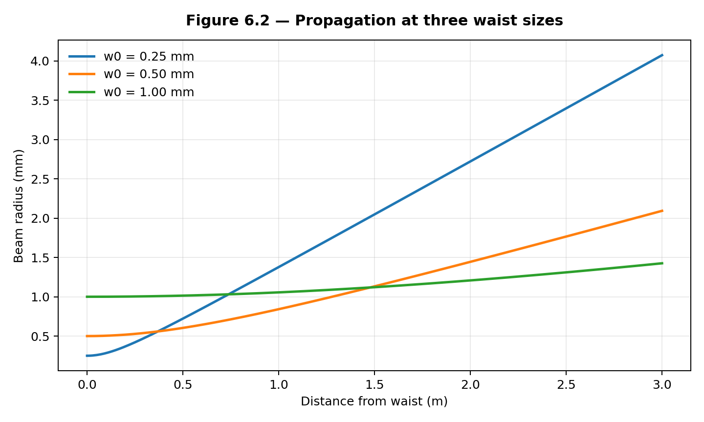
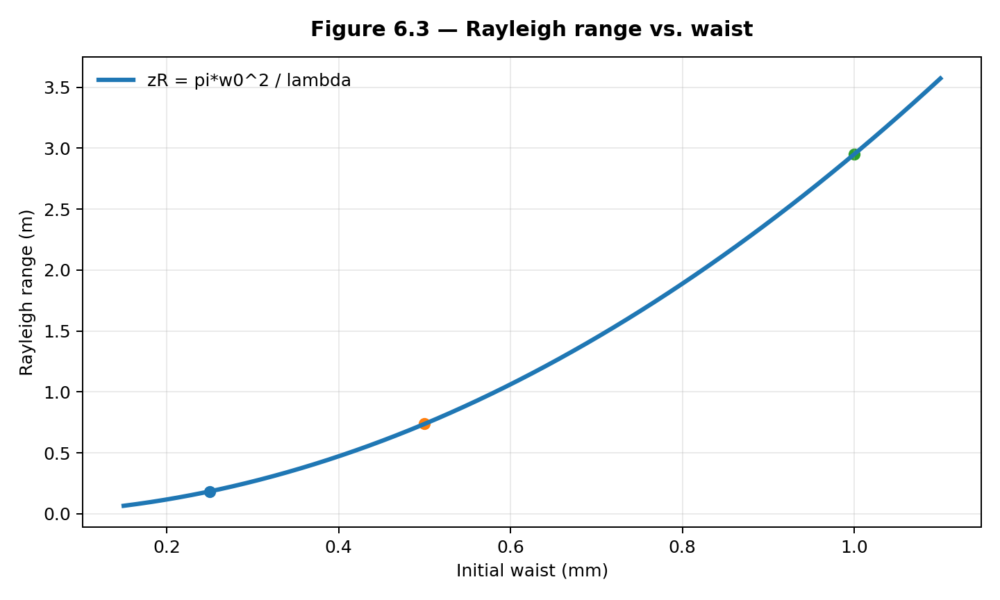
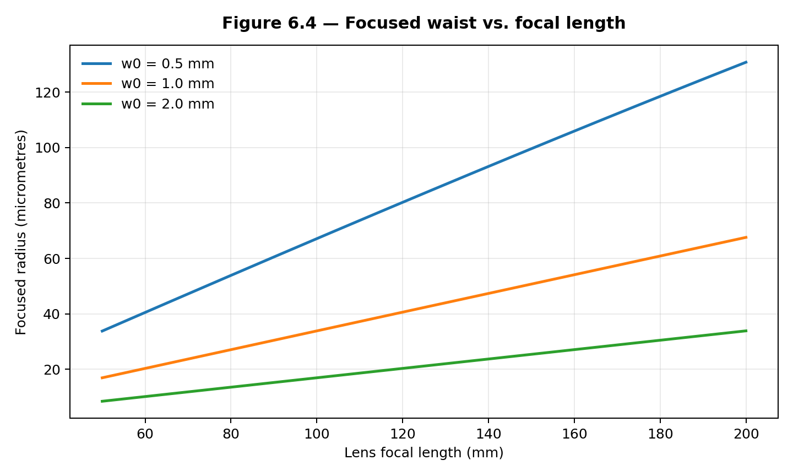
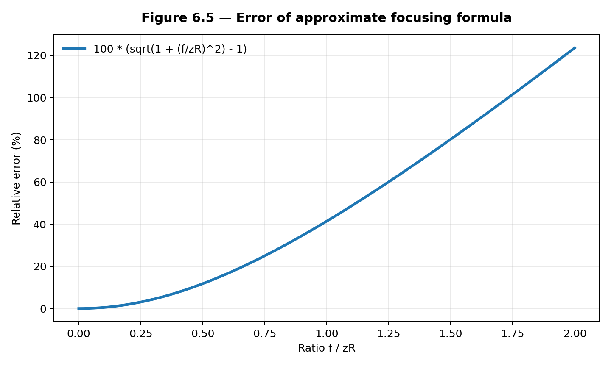
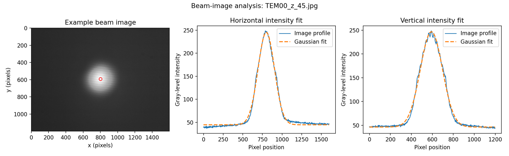
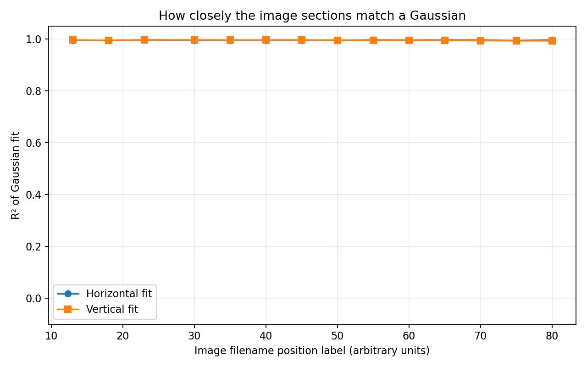

# Gaussian Beam Propagation and Focusing: Principles and Applications

**Course:** Principle of Laser  
**Author:** MUNTASIR MD FAHIM  
**Major:** Information and Communication Engineering  
**University:** Changchun University of Science and Technology

## Project overview

This repository contains my course dissertation, Python scripts, numerical results, image-analysis results, and presentation. I studied how the radius of an ideal Gaussian beam changes during free-space propagation and thin-lens focusing. I also examined transverse intensity profiles in a published set of laser-beam images using Gaussian curve fitting.

The project has two complementary studies:

1. **Numerical simulation:** analytical Gaussian beam equations evaluated for selected wavelengths, initial beam waists, and thin-lens focal lengths.
2. **Image-based analysis:** Gaussian fitting of horizontal and vertical intensity profiles from 14 published laser-beam images.

The first study predicts ideal optical behavior from known input parameters. The second measures image-profile widths in pixels. They are not presented as measurements from the same calibrated optical setup.

## Dissertation and presentation

- **[Read the final dissertation (PDF)](Gaussian%20Beam%20Propagation%20and%20Focusing.pdf)** — full theory, methodology, results, discussion, and references.
- **[Download the final 15-slide presentation (PPTX)](presentation/Gaussian_Beam_Presentation.pptx)** — summary of the theory and both studies, including speaker notes.

## Experiment 1 — Numerical simulation

In `experiment.py`, I used the paraxial TEM₀₀ Gaussian-beam model to calculate beam radius, Rayleigh range, far-field divergence, focused-waist radius, and focused-waist position. The simulation contains three parameter studies and a check on the accuracy of a common focusing approximation. All numerical quantities are predictions from ideal equations, not laboratory observations.

### Numerical results

**Study A — Effect of wavelength.** Initial beam waist: 0.50 mm. The longer wavelengths produce larger calculated beam radii at the same propagation distance.

| Wavelength (nm) | Rayleigh range (m) | Half-angle (mrad) | Radius at 1 m (mm) | Radius at 2 m (mm) |
| --- | --- | --- | --- | --- |
| 532 | 1.4763 | 0.3387 | 0.6039 | 0.8419 |
| 1064 | 0.7382 | 0.6774 | 0.8419 | 1.4441 |
| 1550 | 0.5067 | 0.9868 | 1.1062 | 2.0359 |

[Full CSV — Study A](outputs/numerical/tables/table_6_2_wavelength.csv)

**Study B — Effect of the initial waist.** Wavelength: 1064 nm. A larger waist increases the Rayleigh range and decreases the far-field divergence.

| Initial waist (mm) | Rayleigh range (m) | Half-angle (mrad) | Radius at 1 m (mm) | Radius at 3 m (mm) |
| --- | --- | --- | --- | --- |
| 0.25 | 0.1845 | 1.3547 | 1.3776 | 4.0719 |
| 0.50 | 0.7382 | 0.6774 | 0.8419 | 2.0927 |
| 1.00 | 2.9526 | 0.3387 | 1.0558 | 1.4256 |

[Full CSV — Study B](outputs/numerical/tables/table_6_3_waist.csv)

**Study C — Thin-lens focusing.** Wavelength: 1064 nm; the incoming beam waist is at the lens plane. The exact Gaussian calculation shows that the focused waist depends on both the input radius and focal length.

| Input waist (mm) | Focal length (mm) | New waist position (mm) | Focused waist (µm) | Approx. error (%) |
| --- | --- | --- | --- | --- |
| 0.50 | 50 | 49.77 | 33.79 | 0.229 |
| 0.50 | 100 | 98.20 | 67.12 | 0.913 |
| 0.50 | 200 | 186.32 | 130.76 | 3.606 |
| 1.00 | 50 | 49.99 | 16.93 | 0.014 |
| 1.00 | 100 | 99.89 | 33.85 | 0.057 |
| 1.00 | 200 | 199.09 | 67.58 | 0.229 |
| 2.00 | 50 | 50.00 | 8.47 | 0.001 |
| 2.00 | 100 | 99.99 | 16.93 | 0.004 |
| 2.00 | 200 | 199.94 | 33.86 | 0.014 |

[Full CSV — Study C](outputs/numerical/tables/table_6_4_lens.csv)

**Focusing approximation error.** For a waist placed at the lens, the simpler focal-radius approximation becomes less accurate as the ratio `f/zR` increases.

| f/zR | Radius overestimate (%) | Exact waist position / f |
| --- | --- | --- |
| 0.05 | 0.12 | 0.9975 |
| 0.10 | 0.50 | 0.9901 |
| 0.30 | 4.40 | 0.9174 |
| 0.50 | 11.80 | 0.8000 |
| 1.00 | 41.42 | 0.5000 |
| 2.00 | 123.61 | 0.2000 |

[Full CSV — approximation error](outputs/numerical/tables/table_6_5_error.csv)

### Figures from Experiment 1

The five plots below were generated by the numerical simulation.

**Figure 6.1 — Effect of wavelength on propagation**


**Figure 6.2 — Effect of the initial beam waist**



**Figure 6.3 — Rayleigh range versus initial waist**



**Figure 6.4 — Focused waist versus lens focal length**



**Figure 6.5 — Approximation error in lens focusing**



## Experiment 2 — Gaussian fitting of laser-beam images

In `analyze_beam_images.py`, I analyzed 14 `TEM00_z_*.jpg` images provided through the [DataLab laser-beam profiling tutorial](https://datalab-platform.com/en/intro/tutorials/laser_beam.html). These are published example images, not photographs collected by me in a laboratory.

For each image, the program estimates the beam centre, extracts averaged horizontal and vertical intensity profiles, and fits a Gaussian model with a background term using nonlinear least squares. The saved results include the 1/e² intensity radii, full width at half maximum (FWHM), and R² goodness-of-fit values.

### Image-analysis results

Across the 14 images, the fitted horizontal radii range from **163.83 to 297.96 pixels**, and the vertical radii range from **164.97 to 304.00 pixels**. The 28 profile-fit R² values range from **0.9927 to 0.9959**. The sequence shows a general increase in fitted width, with close Gaussian fits to the extracted one-dimensional intensity profiles.

The table below lists the beam radii and fit scores. The complete CSV additionally records FWHM, background level, and the proportion of saturated pixels.

| Image | wx (px) | wy (px) | R² x | R² y |
| --- | --- | --- | --- | --- |
| TEM00_z_13.jpg | 164.23 | 164.97 | 0.9938 | 0.9957 |
| TEM00_z_18.jpg | 163.83 | 171.17 | 0.9937 | 0.9939 |
| TEM00_z_23.jpg | 172.98 | 178.57 | 0.9959 | 0.9955 |
| TEM00_z_30.jpg | 180.81 | 184.36 | 0.9945 | 0.9959 |
| TEM00_z_35.jpg | 189.70 | 191.60 | 0.9935 | 0.9954 |
| TEM00_z_40.jpg | 197.25 | 201.54 | 0.9951 | 0.9955 |
| TEM00_z_45.jpg | 209.55 | 211.93 | 0.9951 | 0.9956 |
| TEM00_z_50.jpg | 221.17 | 222.14 | 0.9946 | 0.9952 |
| TEM00_z_55.jpg | 232.67 | 238.22 | 0.9956 | 0.9943 |
| TEM00_z_60.jpg | 245.34 | 248.77 | 0.9952 | 0.9947 |
| TEM00_z_65.jpg | 257.93 | 264.04 | 0.9953 | 0.9939 |
| TEM00_z_70.jpg | 270.86 | 277.57 | 0.9950 | 0.9934 |
| TEM00_z_75.jpg | 284.45 | 293.22 | 0.9937 | 0.9927 |
| TEM00_z_80.jpg | 297.96 | 304.00 | 0.9953 | 0.9928 |

[Complete 14-image measurement CSV](outputs/image_analysis/beam_measurements.csv)

### Figures from Experiment 2

The three figures below come from the saved image-analysis results.

**Figure 6.6 — Example laser image and horizontal/vertical Gaussian fits**



**Figure 6.7 — Fitted beam radii across 14 images**


**Figure 6.8 — Fit quality across 14 images**



## Project files

| File or folder | Contents |
| --- | --- |
| `Gaussian Beam Propagation and Focusing.pdf` | Course dissertation |
| `presentation/Gaussian_Beam_Presentation.pptx` | Final 15-slide presentation with notes |
| `experiment.py` | Numerical propagation and focusing calculations |
| `analyze_beam_images.py` | Gaussian fitting of intensity profiles |
| `download_source_images.py` | Helper for obtaining the published DataLab images |
| `requirements.txt` | Python dependencies |
| `outputs/numerical/figures/` | Five numerical figures |
| `outputs/numerical/tables/` | Four numerical CSV tables |
| `outputs/image_analysis/` | Three image-analysis figures and 14-image results CSV |
| `data/README.md` | Data-source information |

## Running the code

I used Python 3.11. From the project folder, install the required packages:

```bash
python -m pip install -r requirements.txt
```

Run the numerical simulation:

```bash
python experiment.py
```

To repeat the image fitting, obtain the DataLab image archive and run:

```bash
python download_source_images.py
python analyze_beam_images.py
```

If the automatic download does not work, download `laser_beam.zip` from the [DataLab tutorial](https://datalab-platform.com/en/intro/tutorials/laser_beam.html) and place it inside `data/`. The image-analysis script reads the ZIP directly.

Both scripts save results in `outputs/`. The numerical simulation can be rerun with the repository files. The saved image measurements and figures can be viewed immediately, but running the image fitting again requires the original JPEG archive, which is **not included** in this repository.

## Interpretation and limitations

The numerical study uses ideal Gaussian beam equations and selected input parameters. The second study uses publicly available images and reports fitted spatial widths in **pixels**. The `z` numbers in the image filenames are labels for the saved image sequence, not independently verified propagation distances in millimetres.

Therefore, the results do not establish a calibrated experimental Rayleigh range, a physical beam waist in millimetres, or a measured beam-quality factor M². Those quantities would require additional information about the optical setup and spatial and axial calibration. A good one-dimensional Gaussian fit also does not by itself prove that a beam is an ideal TEM₀₀ mode.

## Data source

DataLab Platform. *Laser beam profiling: measuring beam size along the propagation axis*. [Tutorial and example image dataset](https://datalab-platform.com/en/intro/tutorials/laser_beam.html).
