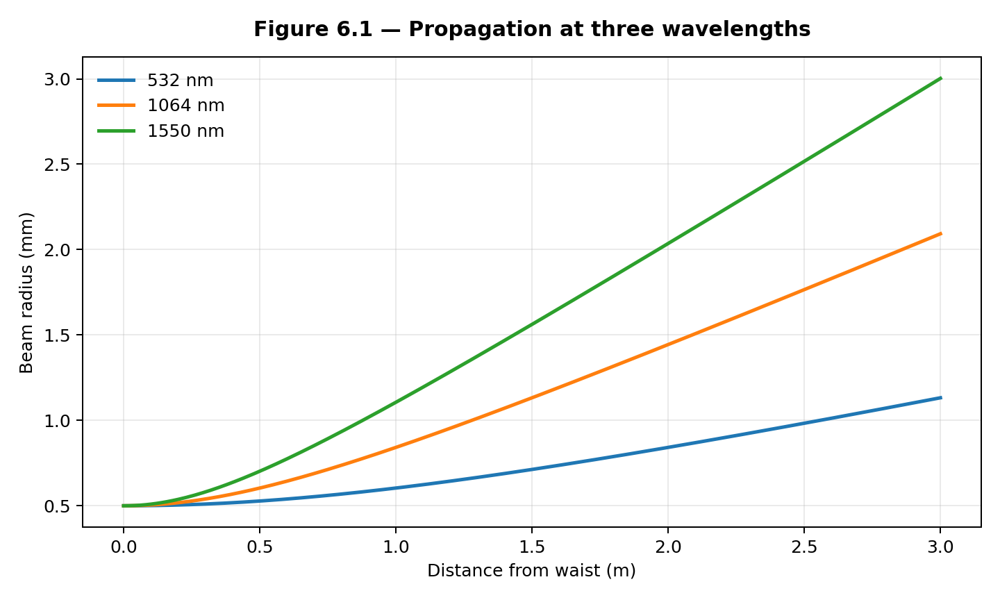
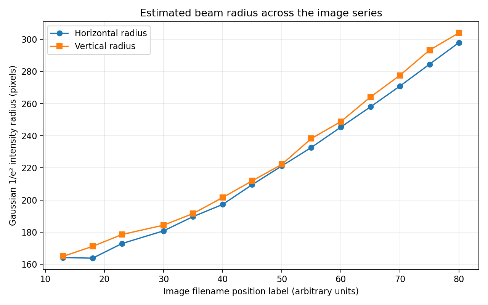

# Gaussian Beam Propagation and Focusing: Principles and Applications

**Principle of Laser — final course project**  
**MUNTASIR MD FAHIM**  
Information and Communication Engineering

This repository contains the Python work from my course dissertation. I examined
how the radius of an ideal Gaussian beam changes during propagation and focusing,
and then analyzed a set of published laser-beam images to study the intensity
profiles. The two studies use different types of data, so I report them separately.

## Experiments

### 1. Gaussian beam propagation and focusing

In `experiment.py` I calculated the beam radius, Rayleigh range, divergence, and
focused waist using ideal TEM00 beam equations. I compared three wavelengths,
three starting waist sizes, and several thin-lens focal lengths. I also checked
the error in the approximate focusing equation.

The numerical study produced **five figures and four CSV tables**.



### 2. Gaussian fitting of laser-beam images

In `analyze_beam_images.py` I used 14 example `TEM00_z_*.jpg` images from the
[DataLab laser-beam tutorial](https://datalab-platform.com/en/intro/tutorials/laser_beam.html).
For each image, the script locates the beam centre, extracts averaged horizontal
and vertical intensity profiles, and fits a Gaussian curve by nonlinear least
squares. The results include 1/e² intensity radii, FWHM, and R² fit scores.

The saved results contain **14 measurement rows and three figures**. The fitted
radii in the saved series generally increase from the first to the last image;
the R² values across 28 profile fits are approximately 0.993–0.996.



## Project files

| File or folder | Description |
| --- | --- |
| `experiment.py` | Numerical beam propagation and focusing |
| `analyze_beam_images.py` | Gaussian fitting of image intensity profiles |
| `download_source_images.py` | Fetches the public example image archive |
| `requirements.txt` | Required Python packages |
| `outputs/numerical/tables/` | Four CSV tables from Experiment 1 |
| `outputs/numerical/figures/` | Five graphs from Experiment 1 |
| `outputs/image_analysis/` | 14-image measurement CSV and three graphs |
| `data/README.md` | Image source and download information |

## Run the code

I used Python 3.11. Install the libraries from the project folder:

```bash
python -m pip install -r requirements.txt
```

Run Experiment 1:

```bash
python experiment.py
```

To repeat the image fitting, first obtain the original DataLab images and
then run the analysis:

```bash
python download_source_images.py
python analyze_beam_images.py
```

If the automatic download is unavailable, download `laser_beam.zip` from
[DataLab](https://datalab-platform.com/en/intro/tutorials/laser_beam.html)
and place it inside `data/`. The analysis script reads the ZIP directly.

Both scripts save their plots and CSV files in `outputs/`. The numerical
experiment can be rerun with the files already in this repository. The saved
image measurements and figures can be viewed immediately, but re-fitting the
images requires the original JPEG archive, which is **not included here**.

## Notes on the results

The first study uses chosen input parameters and analytical equations, rather
than measurements from a laboratory laser setup. The second study uses example
images published by DataLab, not photographs I collected myself.

Image radii are measured in **pixels**. The `z` numbers in the filenames are
used as image labels, not calibrated distances in millimetres. A physical
Rayleigh range or beam-quality factor M² cannot be determined reliably from
these saved results without additional calibration and measurement information.

## Data reference

DataLab Platform. *Laser beam profiling: measuring beam size along the
propagation axis*. [Tutorial and image dataset](https://datalab-platform.com/en/intro/tutorials/laser_beam.html).
